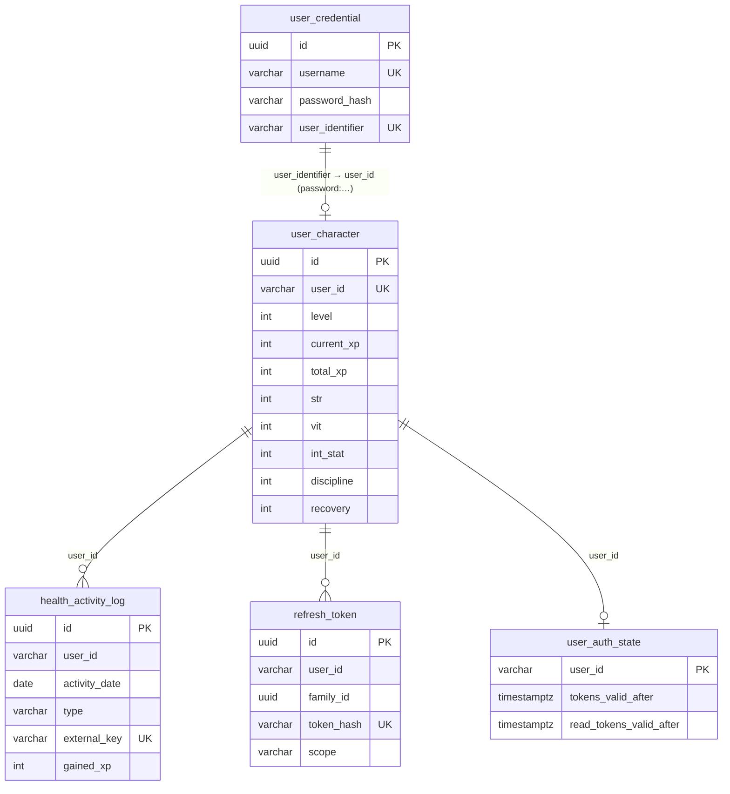

# DB 테이블 구조

> 기준: dev (Flyway V1~V6). PostgreSQL 17 (Supabase, 싱가포르). 원본: [`backend/db/schema.sql`](../backend/db/schema.sql)
> 스키마는 **Spring Flyway 마이그레이션이 관리**하고, Hono 서버는 같은 스키마를 그대로 씁니다(마이그레이션 없음).

## 전체 구조

- **외래키는 없습니다.** 테이블은 문자열 `user_id`로만 이어집니다.
- **`user_id` 형식은 `{로그인 수단}:{식별자}`입니다.** 예: `apple:{sub}`, `google:{sub}`, `kakao:{회원번호}`, `naver:{id}`, `password:{UUID}`.
- 소셜 로그인 사용자는 별도 계정 테이블 없이 `user_id`만으로 식별합니다. 같은 사람이라도 로그인 수단이 다르면 다른 캐릭터입니다.
- `user_character`는 첫 동기화 때 자동으로 만들어집니다. 동기화 전에 조회하면 404입니다.

| 테이블 | 역할 | 생긴 버전 |
|---|---|---|
| `user_character` | 사용자별 캐릭터: 레벨·XP·스탯 | V1 |
| `health_activity_log` | 동기화된 걸음·운동·수면 기록과 지급 XP | V1 |
| `user_credential` | 아이디·비밀번호 계정 | V1 |
| `refresh_token` | 리프레시 토큰(회전·재사용 감지) | V3, V5 |
| `user_auth_state` | 사용자별 토큰 무효화 기준 시각 | V3, V5 |
| `flyway_schema_history` | 마이그레이션 이력(Flyway 관리) | — |

---

## user_character: 캐릭터

| 컬럼 | 타입 | 제약 | 설명 |
|---|---|---|---|
| `id` | uuid | PK | |
| `user_id` | varchar(255) | NOT NULL, **UNIQUE** | 사용자 식별자. 사용자당 캐릭터 1개 |
| `level` | int | NOT NULL | 현재 레벨(1부터) |
| `current_xp` | int | NOT NULL | 현재 레벨에서 쌓인 XP. `100 + (level−1)×50`에 도달하면 레벨업하고 초과분은 이월 |
| `total_xp` | int | NOT NULL | 누적 XP(int 최대값에서 멈춤) |
| `str` | int | | 힘: 근력 운동 위주 |
| `vit` | int | | 체력: 유산소 운동 위주 |
| `int_stat` | int | | 지능: 수면(품질) |
| `discipline` | int | | 규율: 걸음 수(기록·8,000보 달성) |
| `recovery` | int | | 회복: 수면 |
| `created_at`, `updated_at` | timestamptz | NOT NULL | |

- 동기화할 때는 이 행을 **행 잠금(SELECT … FOR UPDATE)**으로 잡습니다. 그래서 같은 사용자의 동시 동기화가 순서대로 처리됩니다.

## health_activity_log: 활동 기록

| 컬럼 | 타입 | 제약 | 설명 |
|---|---|---|---|
| `id` | uuid | PK | |
| `user_id` | varchar(255) | NOT NULL | |
| `activity_date` | date | NOT NULL | 기록이 속한 날짜. 운동은 시작 시각의 KST 날짜, 걸음·수면은 요청의 `date` |
| `type` | varchar(255) | NOT NULL, CHECK `STEPS`·`WORKOUT`·`SLEEP` | |
| `source_type` | varchar(255) | | 운동 종목(`RUNNING`, `SWIMMING`, `STRENGTH_TRAINING`…). 걸음·수면은 종류명 |
| `duration_minutes` | int | | 운동 시간(분) |
| `calories` | numeric(38,2) | | 운동 칼로리(kcal) |
| `distance_meters` | numeric(38,2) | | 운동 거리(m). XP에는 반영하지 않음 |
| `steps` | int | | 걸음 수 |
| `sleep_minutes` | int | | 수면 시간(분) |
| `sleep_score` | int | | 수면 점수 0~100 |
| `gained_xp` | int | NOT NULL | 이 기록으로 **실제 지급된** XP(상한 적용 후, 갱신 시 누적) |
| `external_key` | varchar(512) | NOT NULL, **UNIQUE** | 중복 방지 키(아래) |
| `started_at`, `ended_at` | timestamptz | | 운동·수면 구간 |
| `created_at` | timestamptz | NOT NULL | |

**`external_key` 형식** (같은 키면 같은 기록으로 보고 갱신하거나 중복 처리)

| 종류 | 키 | 의미 |
|---|---|---|
| 걸음 | `{user_id}\|{date}\|STEPS` | 하루 1건. 더 큰 값이 오면 갱신 |
| 수면 | `{user_id}\|{date}\|SLEEP` | 하루 1건. 더 긴 수면이 오면 갱신 |
| 운동 | `{user_id}\|{startedAt}\|{endedAt}\|{종목}` | 운동 1회당 1건 |

**인덱스**
- `idx_health_activity_user_type_time (user_id, type, started_at, ended_at)`: 운동·수면이 시간상 겹치는지 검사
- `idx_health_activity_user_date (user_id, activity_date)`: 날짜별 조회, 하루 XP 합계(상한 계산)

## user_credential: 아이디·비밀번호 계정

| 컬럼 | 타입 | 제약 | 설명 |
|---|---|---|---|
| `id` | uuid | PK | |
| `username` | varchar(32) | NOT NULL, **UNIQUE** | 로그인 아이디. 영문·숫자·`_` 4~32자, 소문자로 저장(#106) |
| `password_hash` | varchar(100) | NOT NULL | BCrypt(cost 10). 평문은 저장하지 않음 |
| `user_identifier` | varchar(64) | NOT NULL, **UNIQUE** | 내부 식별 UUID. 이 계정의 `user_id`는 `password:{user_identifier}` |
| `display_name` | varchar(64) | | 닉네임 |
| `created_at`, `updated_at` | timestamptz | NOT NULL | |

## refresh_token: 리프레시 토큰

| 컬럼 | 타입 | 제약 | 설명 |
|---|---|---|---|
| `id` | uuid | PK | |
| `user_id` | varchar(255) | NOT NULL | |
| `family_id` | uuid | NOT NULL | 한 번의 로그인에서 이어지는 토큰 묶음. 재사용이 감지되면 family 전체를 폐기 |
| `family_created_at` | timestamptz | NOT NULL | 로그인 시각. 절대 수명(앱 90일, 웹 30일) 기준 |
| `token_hash` | varchar(64) | NOT NULL, **UNIQUE** | 토큰의 SHA-256. **원문은 저장하지 않음** |
| `issued_at` | timestamptz | NOT NULL | |
| `expires_at` | timestamptz | NOT NULL | 유휴 만료(앱 30일, 웹 7일. 회전마다 다시 시작) |
| `revoked_at` | timestamptz | | 폐기·회전된 시각 |
| `replaced_by` | uuid | | 회전으로 이 토큰을 대신한 새 토큰 id |
| `scope` | varchar(16) | NOT NULL, 기본 `full`, CHECK `full`·`read` | `full` = 앱(쓰기 가능), `read` = 웹 대시보드(조회 전용). 회전해도 유지(V5) |
| `grace_reissued` | boolean | NOT NULL, 기본 false | 회전 후 30초 유예 안의 재발급을 이미 한 번 했는지. 두 번째는 재사용 공격으로 보고 폐기(V5) |

**인덱스:** `family_id`(family 단위 잠금·폐기), `user_id`(전체 로그아웃), `expires_at`(매일 04:00 만료 행 정리)

## user_auth_state: 토큰 무효화 기준

| 컬럼 | 타입 | 제약 | 설명 |
|---|---|---|---|
| `user_id` | varchar(255) | PK | |
| `tokens_valid_after` | timestamptz | NOT NULL | 이 시각 이전에 발급된 **모든** 액세스 토큰 거부. 모든 기기 로그아웃이나 재사용 감지 때 갱신. `1970-01-01`이면 기준 없음 |
| `read_tokens_valid_after` | timestamptz | | 조회 전용(Watch·웹) 토큰만의 기준. 앱에서 로그아웃할 때 갱신(V5) |

- 서버는 이 값을 사용자별로 30초 동안 메모리에 캐시합니다.

---

## 보안 설정

- **RLS(행 수준 보안):** 모든 테이블에 켜져 있고, 허용 정책은 없습니다(V4). 서버는 테이블 소유자(`postgres`)로 접속하므로 영향이 없습니다. Supabase 공개 키(anon)로는 어떤 행도 읽을 수 없습니다.
- **권한 회수:** Supabase API 역할(`anon`, `authenticated`)의 테이블·시퀀스·함수 권한을 모두 회수했습니다(V6).
- **`flyway_schema_history` 예외:** 마이그레이션 중 잠금 교착 문제 때문에 V4·V6 대상에서 빠집니다. 운영 DB에서는 RLS와 권한 회수를 직접 적용했습니다. 새 DB를 만들면 README의 수동 절차를 따릅니다.
- **민감 정보 저장 방식:** 비밀번호는 BCrypt 해시, 토큰은 SHA-256 해시만 저장합니다.

## 마이그레이션 이력

| 버전 | 종류 | 내용 |
|---|---|---|
| V1 | SQL | 기본 테이블: `user_character`, `health_activity_log`, `user_credential` |
| V2 | Java | 이전 형식 수면 기록의 키 정리(데이터만 변경) |
| V3 | SQL | Auth v2: `refresh_token`, `user_auth_state` |
| V4 | Java | 모든 테이블 RLS(PostgreSQL에서만) |
| V5 | Java | `refresh_token.scope`·`grace_reissued`, `user_auth_state.read_tokens_valid_after` (lock_timeout 5초) |
| V6 | Java | Supabase API 역할 권한 회수(PostgreSQL에서만) |

마이그레이션을 추가하면 `backend/db/schema.sql`과 이 문서도 함께 고칩니다. `schema.sql`이 실제 스키마와 같은지는 CI의 `postgresTest`가 검사합니다.
