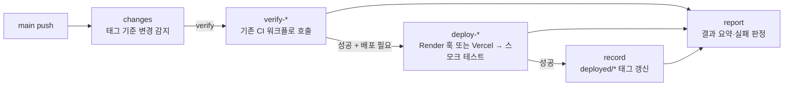

# 배포 파이프라인

`main`에 머지되면 `.github/workflows/deploy.yml`이 대상(backend·hono·web)별로 **마지막 성공 배포 이후 바뀐 것만** 검증한 뒤 배포합니다.
Render·Vercel의 자체 자동 배포는 꺼 두어 한 번의 머지가 두 번 배포되지 않게 합니다.

## 흐름



| 대상 | 배포 필요 조건 (마지막 성공 배포 태그 이후) | 서비스 | 배포 방식 | 주소 |
|---|---|---|---|---|
| backend | `backend/**` 변경 | Render `wellness-game-api` (`srv-dbac3sijnfac73f5d1ng`) | 배포 훅 POST(`&ref=<커밋>`) → 그 배포가 live 될 때까지 대기 → `/healthz` | https://wellness-game-api.onrender.com |
| hono | `hono-server/**`, `backend/db/schema.sql`, `backend/src/main/resources/messages*.properties` 변경 | Render `wellness-game-hono` (`srv-dbc5oee1egvs739k01ag`) | 배포 훅 POST(`&ref=<커밋>`) → live 대기 → `/healthz` | https://wellness-game-hono.onrender.com |
| web | `web/**` 변경 | Vercel `wellness-game` (Root Directory `web`) | `vercel pull` → `vercel build --prod` → `vercel deploy --prebuilt --prod` → `/`, `/privacy` 확인 | https://wellness-game-kohl.vercel.app |

### 변경 감지 규칙

- **배포 기준:** 대상마다 태그 `deployed/backend`, `deployed/hono`, `deployed/web`이 있습니다. 태그는 **스모크 테스트까지 통과한 배포의 커밋**으로 강제 갱신됩니다. 실패하거나 취소된 배포는 태그를 옮기지 않으므로, 그 변경은 다음 실행에서 다시 배포됩니다.
- **태그가 없는 대상**은 항상 전체 배포합니다(처음 도입할 때 한 번, 또는 태그를 지웠을 때).
- **검증:** 배포하는 대상은 항상 검증합니다. 배포 워크플로(`deploy.yml`)나 해당 CI 워크플로가 바뀐 push에서는 그 대상들을 검증만 합니다(배포는 하지 않음).
- **주간 검증:** 매주 월요일 03:00 KST에 전 대상을 검증만 합니다(배포 없음). 배포되지 않은 채로 깨진 상태를 일찍 찾기 위해서입니다.
- 검증은 기존 CI 워크플로(`backend-ci.yml`, `hono-ci.yml`, `web-ci.yml`)를 `workflow_call`로 호출합니다. `main` push에서는 이 세 워크플로를 따로 돌리지 않습니다(중복 방지).

### 동시성

- 배포 실행은 `deploy-production` 그룹에서 한 번에 하나만 진행하며 취소하지 않습니다.
- 검증 워크플로는 `main`에서 취소하지 않습니다. 취소되면 그 커밋의 배포가 빠지기 때문입니다. PR 실행은 기존처럼 같은 PR의 이전 실행을 취소합니다.

## 시크릿과 변수

**시크릿은 `production` 환경 시크릿**으로 저장합니다. 배포 잡은 `environment: production`을 지정하므로 이 환경에서만 값을 읽습니다.
변수(아이디·URL 같은 비밀이 아닌 값)는 저장소 변수로 둡니다.

| 이름 | 종류 | 필수 | 값을 얻는 곳 |
|---|---|---|---|
| `RENDER_DEPLOY_HOOK_API` | 환경 시크릿 | 필수 | Render 대시보드 › `wellness-game-api` › **Settings › Deploy Hook** 의 URL |
| `RENDER_DEPLOY_HOOK_HONO` | 환경 시크릿 | 필수 | Render 대시보드 › `wellness-game-hono` › **Settings › Deploy Hook** 의 URL |
| `RENDER_API_KEY` | 환경 시크릿 | 필수 | Render 대시보드 › **Account Settings › API Keys**에서 생성. 배포 ID 를 확인하고 live 가 될 때까지 기다리는 데 씁니다 |
| `VERCEL_TOKEN` | 환경 시크릿 | 필수 | Vercel 대시보드 › **Account Settings › Tokens**에서 생성. 범위는 팀 `team_4EowikoAvTyqEpFshzZSpNmm`이 보이도록 설정 |
| `RENDER_SERVICE_ID_API` | 저장소 변수 | 필수 | `srv-dbac3sijnfac73f5d1ng` (서비스 URL의 `srv-…` 부분) |
| `RENDER_SERVICE_ID_HONO` | 저장소 변수 | 필수 | `srv-dbc5oee1egvs739k01ag` |
| `VERCEL_ORG_ID` | 저장소 변수 | 필수 | `team_4EowikoAvTyqEpFshzZSpNmm` (Vercel 팀 설정 › General) |
| `VERCEL_PROJECT_ID` | 저장소 변수 | 필수 | `prj_tMeXGM2Ebbobapt8wvqah5GtuKBW` (Vercel 프로젝트 › Settings › General) |

설정 명령 (저장소 루트에서 실행). 시크릿 값은 명령행 인자로 넘기지 않고, 실행 후 나오는 입력창에 붙여넣습니다(셸 기록에 남지 않게):

```bash
# 환경 시크릿 (production)
gh secret set RENDER_DEPLOY_HOOK_API --env production --repo seongkyu-lim/wellness-game
gh secret set RENDER_DEPLOY_HOOK_HONO --env production --repo seongkyu-lim/wellness-game
gh secret set RENDER_API_KEY --env production --repo seongkyu-lim/wellness-game
gh secret set VERCEL_TOKEN --env production --repo seongkyu-lim/wellness-game

# 저장소 변수
gh variable set RENDER_SERVICE_ID_API --repo seongkyu-lim/wellness-game --body '<srv-… (API 서비스 ID)>'
gh variable set RENDER_SERVICE_ID_HONO --repo seongkyu-lim/wellness-game --body '<srv-… (Hono 서비스 ID)>'
gh variable set VERCEL_ORG_ID --repo seongkyu-lim/wellness-game --body '<team_… (Vercel 팀 ID)>'
gh variable set VERCEL_PROJECT_ID --repo seongkyu-lim/wellness-game --body '<prj_… (Vercel 프로젝트 ID)>'

# production 환경 생성
gh api -X PUT repos/seongkyu-lim/wellness-game/environments/production
```

### 배포 브랜치 정책 (production 환경)

`production` 환경의 **Deployment branches and tags**를 **Selected branches and tags**로 두고 **`main` 하나만** 허용합니다.
이렇게 하면 다른 브랜치에서 실행된 워크플로가 production 시크릿을 읽을 수 없습니다. 이 정책은 저장소 관리자가 API로 만듭니다.

누락된 시크릿이나 변수가 있으면 해당 배포 잡의 첫 단계가 어떤 이름을 추가해야 하는지 알려 주고 실패합니다.

## 한 번만 하는 대시보드 작업

1. **Render (두 서비스 모두):** 서비스 › **Settings › Build & Deploy › Auto-Deploy** 를 **Off**로 바꿉니다.
   두 서비스는 Blueprint(`render.yaml`)로 만들지 않았으므로 `render.yaml`의 `autoDeploy: false`만으로는 꺼지지 않습니다.
2. **Render 배포 훅:** 서비스 › **Settings › Deploy Hook**에서 URL을 복사해 위 시크릿에 넣습니다. 파이프라인은 훅 URL에 `ref=<커밋 SHA>`를 붙여 검증한 커밋을 정확히 배포합니다.
3. **Vercel:** Root Directory가 `web`인지 확인합니다. 운영 `main` 배포는 `web/vercel.json`의 `git.deploymentEnabled.main: false`로 Git 연동에서 끕니다. PR 프리뷰는 그대로 유지됩니다. Production Branch는 `main`으로 둡니다.
4. **GitHub `production` 환경:** 필요하면 **Settings › Environments › production**에서 Required reviewers를 추가해 배포 전 수동 승인을 받습니다.

## 최초 도입과 수동 실행

- **최초 1회:** 태그가 없으므로 첫 실행은 전체를 배포합니다. 배포가 끝나면 태그가 생깁니다. 직접 만들려면 **Actions › Deploy › Run workflow**에서 `targets=all`로 실행합니다.
- **수동 배포:** **Actions › Deploy › Run workflow**, Branch는 `main`, `targets`에서 `all`, `backend`, `hono`, `web` 중 하나를 고르고 `verify_only`는 끕니다. 변경 감지 없이 선택한 대상을 검증하고 배포합니다.
- **수동 검증만:** 같은 화면에서 `verify_only`를 켭니다. 배포 없이 선택한 대상만 검증합니다.
- CLI: `gh workflow run deploy.yml --ref main -f targets=backend`
- `main`이 아닌 브랜치에서 실행하면 변경 감지 단계에서 실패합니다.

## 롤백

- **Render (backend, hono):** 서비스 › **Deploys**에서 직전에 live였던 배포를 골라 **Rollback**을 누릅니다. 이 작업은 Actions를 거치지 않으므로 태그는 옮겨지지 않습니다.
- **Vercel (web):** 프로젝트 › **Deployments**에서 직전 운영 배포를 열고 **Promote to Production**(또는 `vercel rollback <배포 URL>`)을 실행합니다.
- **코드로 되돌리기(권장):** 문제 커밋을 되돌리는 PR을 `main`에 머지하면 파이프라인이 그 변경을 다시 검증하고 배포합니다. 기록이 남고 검증도 거칩니다.
- **태그와 롤백:** 대시보드 롤백 뒤에는 태그가 롤백 전 커밋을 가리킵니다. 다음 배포는 그 이후 변경을 모두 포함하므로 문제가 없습니다. 대시보드 롤백 뒤 다음 배포를 막고 싶으면 아무 변경 없이 `targets=<대상>` 수동 실행으로 태그를 맞춥니다.
- **주의:** Flyway 마이그레이션(`backend/src/main/resources/db/migration`)은 롤백되지 않습니다. 스키마를 바꾼 배포는 이전 버전 코드와 호환되는지 먼저 확인합니다.

## 문제 해결

- `시크릿 누락`, `변수 누락`: 위 표의 이름을 확인해 `production` 환경 시크릿 또는 저장소 변수로 추가한 뒤 실패한 실행을 다시 실행합니다.
- `main 이 아닌 ref`: 수동 실행은 Branch를 `main`으로 바꿔 다시 실행합니다.
- `Render 배포 실패`: Render 대시보드의 Deploys 탭에서 빌드 로그를 확인합니다.
- `20분 안에 배포가 live 가 되지 않았습니다`: Render 쪽 빌드가 오래 걸리는 경우입니다. 대시보드에서 진행 상황을 본 뒤 수동 재배포합니다. 태그는 옮겨지지 않았으므로 다음 실행이 같은 변경을 다시 배포합니다.
- `healthz 가 응답하지 않습니다`: 무료 플랜 콜드 스타트는 보통 1분 안에 깨어납니다. 계속 실패하면 Render 로그를 봅니다.
- Vercel 빌드 실패: `VITE_API_BASE_URL`, `VITE_PRIVACY_CONTACT_EMAIL`, `VITE_PRIVACY_EFFECTIVE_DATE` 같은 Vercel 환경변수가 Production에 있는지 확인합니다(`web/README.md` 참고).
- 주간 검증이 실패하면 배포는 하지 않았습니다. 해당 대상의 검증 로그를 보고 `main`에 수정을 머지합니다.

## 알려진 위험

- **Render 훅은 재시도하지 않습니다:** 배포를 만드는 POST라 재시도하면 같은 커밋 배포가 중복될 수 있어 시간 제한(30초)만 둡니다. 실패하면 워크플로를 다시 실행합니다.
- **Vercel 모노레포:** `vercel pull`, `vercel build`, `vercel deploy`를 저장소 루트에서 실행합니다(Root Directory `web`은 프로젝트 설정으로 적용). 첫 실행 로그에서 `web/` 기준으로 빌드되는지 확인합니다. 빌드 단계는 토큰 없이 `pull`이 만든 `.vercel` 설정으로 실행하므로, 이 가정이 맞지 않으면 빌드 단계가 실패합니다.
- **Vercel CLI 버전:** `deploy.yml`의 `VERCEL_CLI_VERSION`으로 고정합니다(현재 `62.5.0`). CLI 설치는 `--ignore-scripts`로 합니다. 올릴 때는 npm 게시 후 2주 이상 지난 버전을 고릅니다.
- **태그 쓰기 권한:** `record` 잡만 `contents: write`를 씁니다. 태그 보호 규칙을 두면 이 잡이 실패하므로 `deployed/*` 태그는 보호하지 않습니다.
- **무료 플랜:** 두 Render 서비스는 free이며 잠들 수 있습니다. 출시 전에는 괜찮지만 운영 전에는 `starter` 이상을 고려합니다(`render.yaml` 주석 참고).

## 관련 파일

- `.github/workflows/deploy.yml`: 변경 감지(태그 기준), 검증 호출, 배포, 태그 갱신, 결과 요약, 주간 검증
- `.github/workflows/backend-ci.yml`, `hono-ci.yml`, `web-ci.yml`: PR 검증과 `workflow_call`
- `render.yaml`: 서비스 정의(`autoDeploy: false`)
- `web/vercel.json`: 빌드 설정과 `main` Git 배포 끄기
